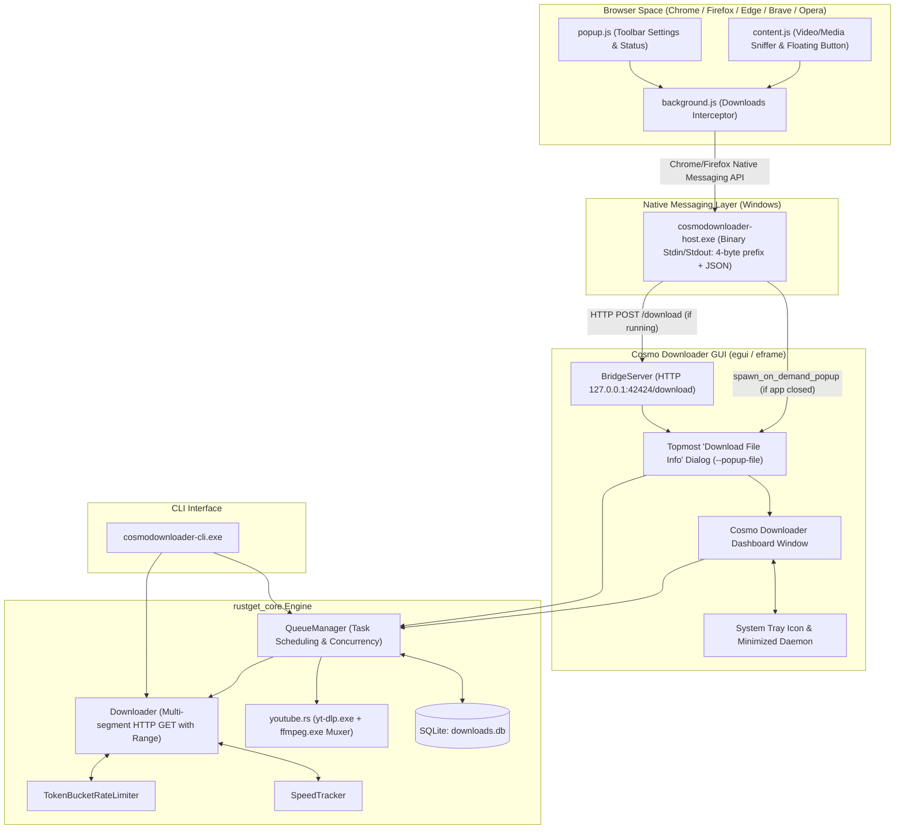

# ✦ Cosmo Downloader — Agent Mind Map & Architecture Guide

> [!IMPORTANT]
> **AGENT DIRECTIVE — DO NOT SEARCH EVERY FILE OR SCAN THE WORKSPACE RECURSIVELY!**
> Always consult this mind map before looking for or modifying code. It maps every component, file, function, and IPC pathway. Directly target the specific files you need via direct file operations (`read_file` or focused edits) rather than sweeping searches across the repository. Never scan `target/`, `dist/`, `.git/`, or binary files.

---

## ⚡ Instant File Lookup Matrix ("Where is What?")

Use this fast-lookup table to pinpoint the exact file for any feature or task:

| If You Need To Touch... | Target File / Directory | Key Structs / Functions / Constants |
| :--- | :--- | :--- |
| **Desktop GUI / Main Window** | [`crates/app/src/main.rs`](file:///home/tokit/Projects/cosmo_downloader/crates/app/src/main.rs) | `CosmoDownloaderApp`, `eframe::App`, `FilterTab`, `render_download_card` |
| **IDM-style "Download File Info" Popup** | [`crates/app/src/main.rs`](file:///home/tokit/Projects/cosmo_downloader/crates/app/src/main.rs) | `show_download_popup_window`, `make_popup_topmost`, `--popup-file` |
| **System Tray & Autostart** | [`crates/app/src/main.rs`](file:///home/tokit/Projects/cosmo_downloader/crates/app/src/main.rs) | `build_system_tray`, `get_autostart_info`, `set_autostart_enabled` |
| **Explorer "Open File / Open Folder"** | [`crates/app/src/main.rs`](file:///home/tokit/Projects/cosmo_downloader/crates/app/src/main.rs) | `shell_open_file`, `shell_open_folder_and_select`, `ShellExecuteExW` |
| **Multi-segment Chunk Downloader** | [`crates/core/src/downloader.rs`](file:///home/tokit/Projects/cosmo_downloader/crates/core/src/downloader.rs) | `Downloader`, `DownloadOptions`, `DownloadProgress`, `download_chunk` |
| **Byte Range & Segment Division** | [`crates/core/src/segment.rs`](file:///home/tokit/Projects/cosmo_downloader/crates/core/src/segment.rs) | `Segment`, `calculate_segments` |
| **URL Probing & Filename Extraction** | [`crates/core/src/probe.rs`](file:///home/tokit/Projects/cosmo_downloader/crates/core/src/probe.rs) | `probe_url`, `FileInfo`, `extract_filename`, `sanitize_filename` |
| **Download Queue & Concurrency** | [`crates/core/src/queue.rs`](file:///home/tokit/Projects/cosmo_downloader/crates/core/src/queue.rs) | `QueueManager`, `QueueEvent`, `start_queue_worker` |
| **SQLite DB & Task Persistence** | [`crates/core/src/db.rs`](file:///home/tokit/Projects/cosmo_downloader/crates/core/src/db.rs) | `Database`, `DownloadRecord`, migrations |
| **Local Bridge Server (IPC HTTP: 42424)** | [`crates/core/src/server.rs`](file:///home/tokit/Projects/cosmo_downloader/crates/core/src/server.rs) | `BridgeServer`, `ExtensionDownloadRequest`, `spawn_on_demand_popup` |
| **YouTube & yt-dlp Video Extraction** | [`crates/core/src/youtube.rs`](file:///home/tokit/Projects/cosmo_downloader/crates/core/src/youtube.rs) | `probe_youtube`, `download_youtube`, `is_youtube_url` |
| **Speed Tracking & Smoothing** | [`crates/core/src/speed.rs`](file:///home/tokit/Projects/cosmo_downloader/crates/core/src/speed.rs) | `SpeedTracker` |
| **Bandwidth Rate Limiting** | [`crates/core/src/rate_limiter.rs`](file:///home/tokit/Projects/cosmo_downloader/crates/core/src/rate_limiter.rs) | `TokenBucketRateLimiter` |
| **Clipboard Auto-detection** | [`crates/core/src/clipboard.rs`](file:///home/tokit/Projects/cosmo_downloader/crates/core/src/clipboard.rs) | `ClipboardMonitor` |
| **File Categories (Video, Music, etc.)** | [`crates/core/src/category.rs`](file:///home/tokit/Projects/cosmo_downloader/crates/core/src/category.rs) | `Category`, `from_extension`, `default_dir` |
| **SHA-256 Checksums** | [`crates/core/src/checksum.rs`](file:///home/tokit/Projects/cosmo_downloader/crates/core/src/checksum.rs) | `compute_sha256`, `verify_sha256` |
| **Core Exports & Module Tree** | [`crates/core/src/lib.rs`](file:///home/tokit/Projects/cosmo_downloader/crates/core/src/lib.rs) | Public crate re-exports |
| **Browser Native Messaging Host** | [`crates/native-host/src/main.rs`](file:///home/tokit/Projects/cosmo_downloader/crates/native-host/src/main.rs) | `ExtensionMessage`, `HostResponse`, `--register`, `--unregister` |
| **Command Line Interface (CLI)** | [`crates/cli/src/main.rs`](file:///home/tokit/Projects/cosmo_downloader/crates/cli/src/main.rs) | `Cli`, `Commands` (`Download`, `List`, `Pause`, `Probe`, etc.) |
| **Chrome / Edge Extension (V3)** | [`browser-extensions/Chrome-Edge-Brave-Opera/`](file:///home/tokit/Projects/cosmo_downloader/browser-extensions/Chrome-Edge-Brave-Opera/) | `manifest.json`, `background.js`, `content.js`, `popup.js` |
| **Firefox Extension (V2)** | [`browser-extensions/Mozilla-Firefox/`](file:///home/tokit/Projects/cosmo_downloader/browser-extensions/Mozilla-Firefox/) | `manifest.json`, `background.js`, `content.js`, `popup.js` |
| **Inno Setup Windows Installer** | [`installer/cosmodownloader.iss`](file:///home/tokit/Projects/cosmo_downloader/installer/cosmodownloader.iss) | Inno Setup directives, registry entries, shortcuts |
| **Release Build Automation** | [`installer/build-release.ps1`](file:///home/tokit/Projects/cosmo_downloader/installer/build-release.ps1) | Cargo release build + packaging + Inno compile script |
| **Build & Deploy Utility Scripts** | [`scripts/`](file:///home/tokit/Projects/cosmo_downloader/scripts/) | `deploy_binaries.ps1`, `build_xpi.ps1`, `update_manifests.ps1` |

---

## 🏛️ System Architecture & IPC Flow



---

## 📁 Complete Repository Directory Map

```
cosmo_downloader/
├── .agent/                             # 🧠 Agent instructions & architectural mind maps
│   ├── MINDMAP.md                      # THIS FILE: Master mind map & fast routing matrix
│   ├── INSTRUCTIONS.md                 # Agent behavior rules (no useless searches)
│   └── README.md                       # Navigation index for agents
├── .agents                             # Symlink to .agent/ for compatibility
├── Cargo.toml                          # Workspace root configuration (core, cli, app, native-host)
├── Cargo.lock                          # Dependency lockfile
├── README.md                           # User-facing README & setup instructions
├── icon.ico                            # Main application icon (multi-resolution Windows ICO)
├── ffmpeg.exe                          # (Local/optional) Bundled ffmpeg binary (gitignored)
├── yt-dlp.exe                          # (Local/optional) Bundled yt-dlp binary (gitignored)
│
├── crates/                             # 🦀 Rust Workspace Crates
│   ├── app/                            # 🖥️ Desktop GUI (CosmoDownloader.exe)
│   │   ├── Cargo.toml                  # GUI dependencies: eframe, egui, tray-icon, windows APIs
│   │   ├── build.rs                    # Windows resource compiler (embeds app.rc / icon)
│   │   ├── app.rc                      # Win32 resource script (IDI_ICON1 ICON "icon.ico")
│   │   └── src/
│   │       ├── main.rs                 # Complete UI implementation (~2300 lines)
│   │       │                           # - CosmoDownloaderApp & eframe loop
│   │       │                           # - IDM-style download popup dialog
│   │       │                           # - System tray, autostart registry keys
│   │       │                           # - Win32 ShellExecuteExW integration
│   │       └── icon_32.rgba            # Embedded 32x32 RGBA tray icon
│   │
│   ├── core/                           # ⚙️ Core Engine Library (rustget_core)
│   │   ├── Cargo.toml                  # Core dependencies: tokio, reqwest, rusqlite, etc.
│   │   ├── tests/
│   │   │   └── integration_tests.rs    # Integration test suite with mock HTTP server
│   │   └── src/
│   │       ├── lib.rs                  # Module declarations and top-level re-exports
│   │       ├── category.rs             # File extension classification (Video, Music, Docs...)
│   │       ├── checksum.rs             # SHA-256 computation and verification routines
│   │       ├── clipboard.rs            # Background clipboard monitoring for URLs
│   │       ├── db.rs                   # SQLite database management (rusqlite), schema migrations
│   │       ├── downloader.rs           # Multi-segment chunk downloader with Range requests
│   │       ├── error.rs                # Custom error types (DownloadError, Result)
│   │       ├── probe.rs                # URL inspection (HEAD/GET, size, range, Content-Disposition)
│   │       ├── queue.rs                # Concurrency queue manager (max active, worker loop)
│   │       ├── rate_limiter.rs         # Token-bucket rate limiter for speed limiting
│   │       ├── segment.rs              # Chunk calculation & segment division logic
│   │       ├── server.rs               # Loopback HTTP server (127.0.0.1:42424) & popup IPC
│   │       ├── speed.rs                # Instantaneous and smoothed speed tracker
│   │       ├── state.rs                # Task lifecycle state machine & metadata
│   │       └── youtube.rs              # Wrapper executing yt-dlp.exe & ffmpeg.exe
│   │
│   ├── native-host/                    # 🌐 Browser Native Messaging Host (cosmodownloader-host.exe)
│   │   ├── Cargo.toml                  # Host dependencies: serde, serde_json, tracing
│   │   ├── build.rs                    # Windows resource compiler
│   │   ├── app.rc                      # Win32 resource script
│   │   └── src/
│   │       └── main.rs                 # 4-byte length prefix Native Messaging protocol handler
│   │                                   # - Ping, Download, Status handling
│   │                                   # - Registry manifest installation (--register, --unregister)
│   │                                   # - Relays to HTTP bridge or spawns popup on demand
│   │
│   └── cli/                            # 💻 Command Line Interface (cosmodownloader-cli.exe)
│       ├── Cargo.toml                  # CLI dependencies: clap, anyhow
│       ├── build.rs                    # Windows resource compiler
│       ├── app.rc                      # Win32 resource script
│       └── src/
│           └── main.rs                 # CLI entrypoint with subcommands (download, list, pause...)
│
├── browser-extensions/                 # 🧩 Web Extensions for Browser Interception
│   ├── Chrome-Edge-Brave-Opera/        # Manifest V3 extension for Chromium-based browsers
│   │   ├── manifest.json               # Chrome extension manifest (declarativeNetRequest, downloads)
│   │   ├── background.js               # Download interception via chrome.downloads.onDeterminingFilename
│   │   ├── content.js                  # Video element sniffer & in-page floating download widget
│   │   ├── content.css                 # Styling for floating media download widget
│   │   ├── popup.html / popup.js / css # Toolbar action popup for extension status
│   │   ├── icons/                      # Extension icons (16, 32, 48, 128 px)
│   │   └── com.cosmodownloader.*.json   # Native messaging host manifests (Chrome, Edge, Firefox)
│   │
│   ├── Mozilla-Firefox/                # Manifest V2 extension for Firefox
│   │   ├── manifest.json               # Firefox extension manifest (gecko ID, downloads)
│   │   ├── background.js               # Download interception for Gecko browser engine
│   │   ├── content.js / content.css    # In-page media grabber
│   │   ├── popup.html / popup.js / css # Toolbar action popup
│   │   └── icons/                      # Extension icons
│   │
│   └── [prebuilt zips & manifests]     # Packaged extensions & native JSON descriptors
│
├── installer/                          # 📦 Windows Installer Packaging (Inno Setup)
│   ├── cosmodownloader.iss             # Primary Inno Setup script (compiles with ISCC.exe)
│   ├── build-release.ps1               # PowerShell automated release pipeline script
│   ├── icon.ico                        # Installer wizard icon
│   └── dist/                           # Compiled Windows installer output directory
│
└── scripts/                            # 🛠️ Utility & Build PowerShell Scripts
    ├── build_xpi.ps1                   # Zips Firefox extension into .xpi format
    ├── deploy_binaries.ps1             # Deploys release binaries to output locations
    ├── update_manifests.ps1            # Synchronizes extension versions across manifests
    ├── generate_icons.ps1              # Generates ICO files from source images
    ├── generate_cosmic_rgba.ps1        # Generates icon_32.rgba for system tray
    └── [inspect_*.ps1]                 # Icon frame inspection and validation utilities
```

---

## 🔄 Core Lifecycles & Execution Flows

### 1. Browser Download Interception Flow
```
User clicks download in Chrome / Firefox
  │
  ▼
Browser Extension `background.js` catches `chrome.downloads.onDeterminingFilename`
  │ (Cancels default browser download and captures URL, filename, cookies, referer)
  ▼
Extension sends message via Native Messaging port to `cosmodownloader-host.exe`
  │ (4-byte length prefix + JSON payload)
  ▼
`cosmodownloader-host.exe`:
  ├── First attempts HTTP POST to `http://127.0.0.1:42424/download` (BridgeServer)
  │     └── If GUI is running: BridgeServer prompts GUI or queues download immediately
  └── If HTTP connection fails (GUI is closed):
        └── Calls `spawn_on_demand_popup(&dl_req)`:
              ├── Writes request JSON to `%TEMP%/cosmo_popup_<pid>_<ts>.json`
              └── Launches `CosmoDownloader.exe --popup-file <path>`
                    └── GUI starts directly into topmost "Download File Info" dialog!
```

### 2. Multi-Segment Downloading Flow
```
`Downloader::start` in `crates/core/src/downloader.rs`
  │
  ├── 1. Probes URL with `probe_url` (crates/core/src/probe.rs)
  │      └── Obtains Content-Length, Accept-Ranges, and extracts true filename
  │
  ├── 2. Calculates byte chunks via `calculate_segments` (crates/core/src/segment.rs)
  │      └── Divides total size into N segments (e.g. 8 connections)
  │
  ├── 3. Spawns Tokio tasks for each segment:
  │      └── Sends HTTP GET with `Range: bytes=start-end`
  │      └── Throttled via `TokenBucketRateLimiter` (crates/core/src/rate_limiter.rs)
  │      └── Tracks instantaneous speed via `SpeedTracker` (crates/core/src/speed.rs)
  │      └── Writes chunk data to temporary part files
  │
  ├── 4. Assembles completed chunks into destination file
  │
  └── 5. Updates task record in SQLite (`crates/core/src/db.rs`) & emits `QueueEvent`
```

---

## 🚫 What NEVER To Do (Agent Rules of Engagement)

1. **NEVER run blanket recursive searches**: Do not run `grep -r`, `find .`, or directory traversals over `target/`, `dist/`, or the whole repo.
2. **NEVER parse binary files as text**: Do not attempt to `read_file` on `ffmpeg.exe`, `yt-dlp.exe`, `.ico`, `.rgba`, `.zip`, `.xpi`, or `.exe`.
3. **NEVER break Native Messaging IPC framing**: The native host relies strictly on 4-byte little-endian length prefix followed by JSON over stdin/stdout. NEVER print standard text logs to stdout in `crates/native-host/src/main.rs` (tracing MUST log to stderr only).
4. **NEVER change the BridgeServer port (42424)** without updating both `crates/core/src/server.rs` and `crates/native-host/src/main.rs`.
